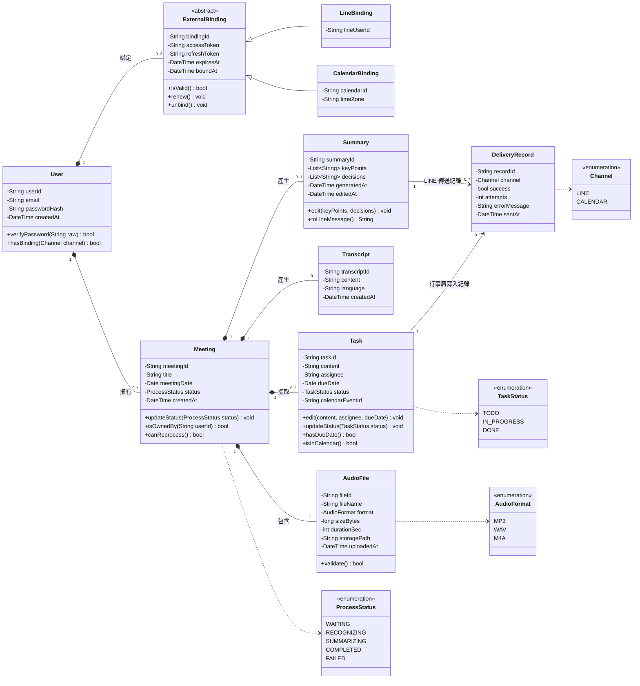
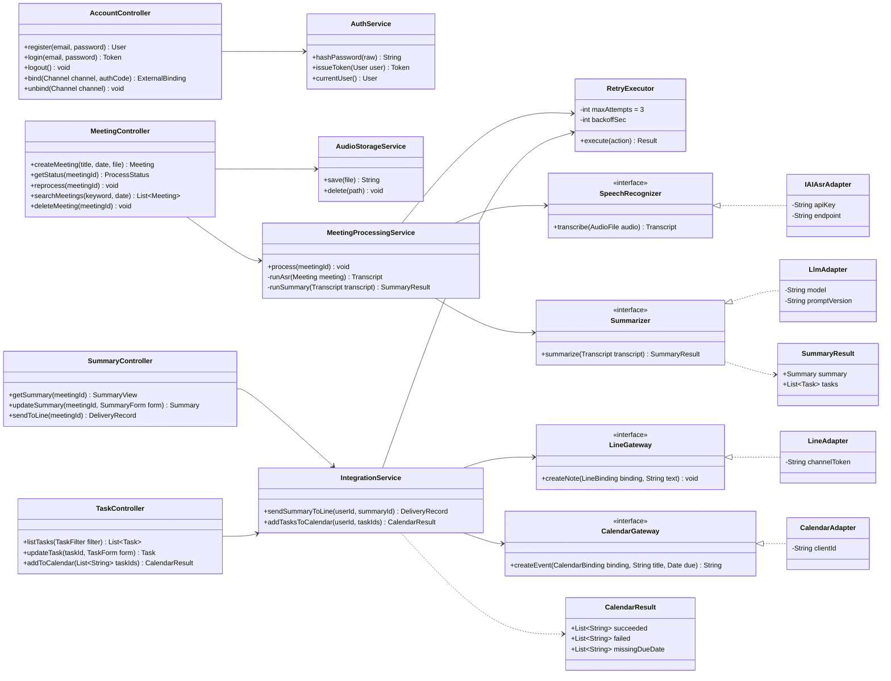
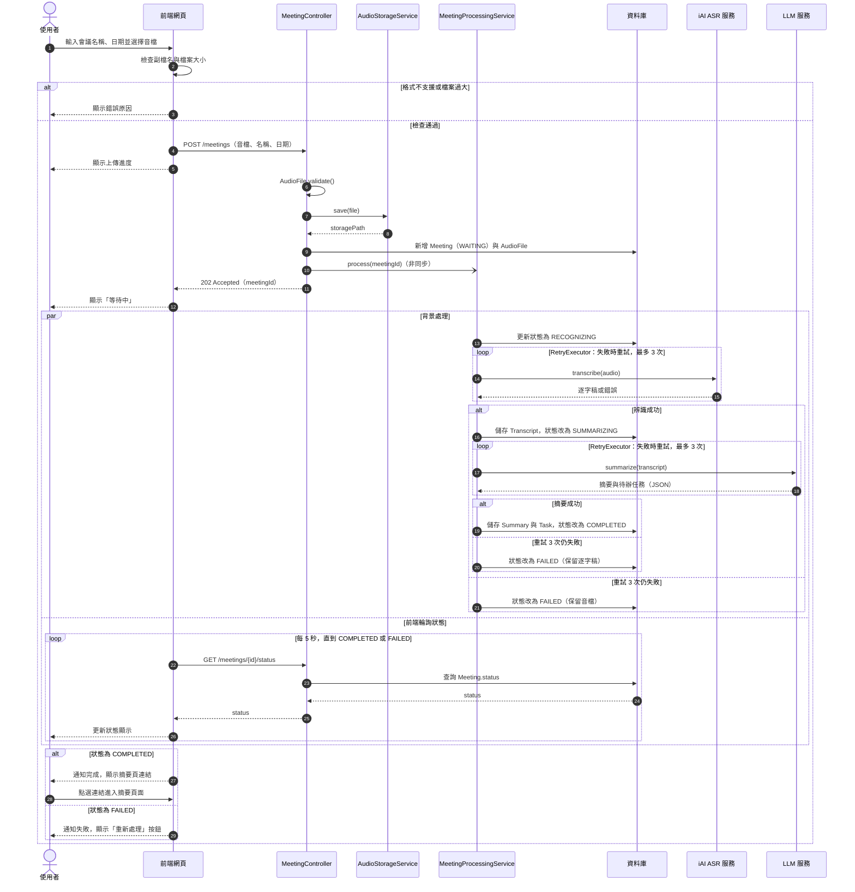
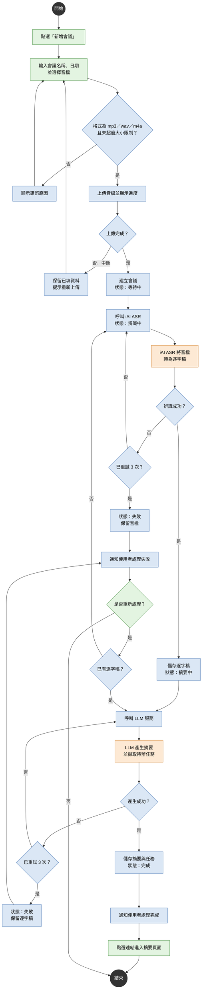
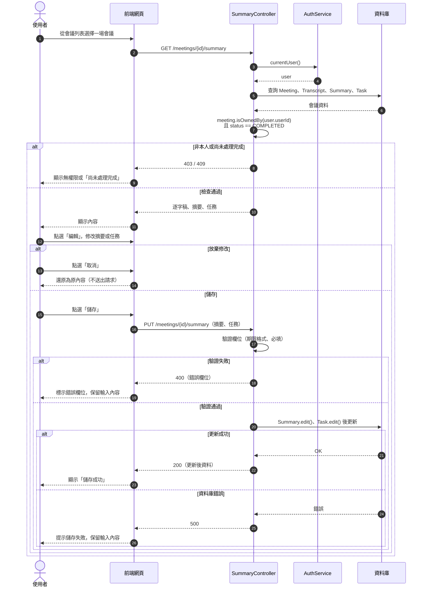
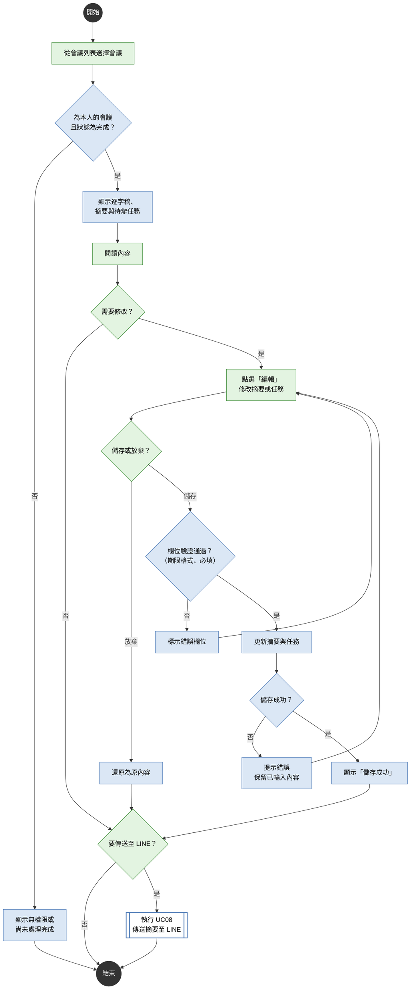
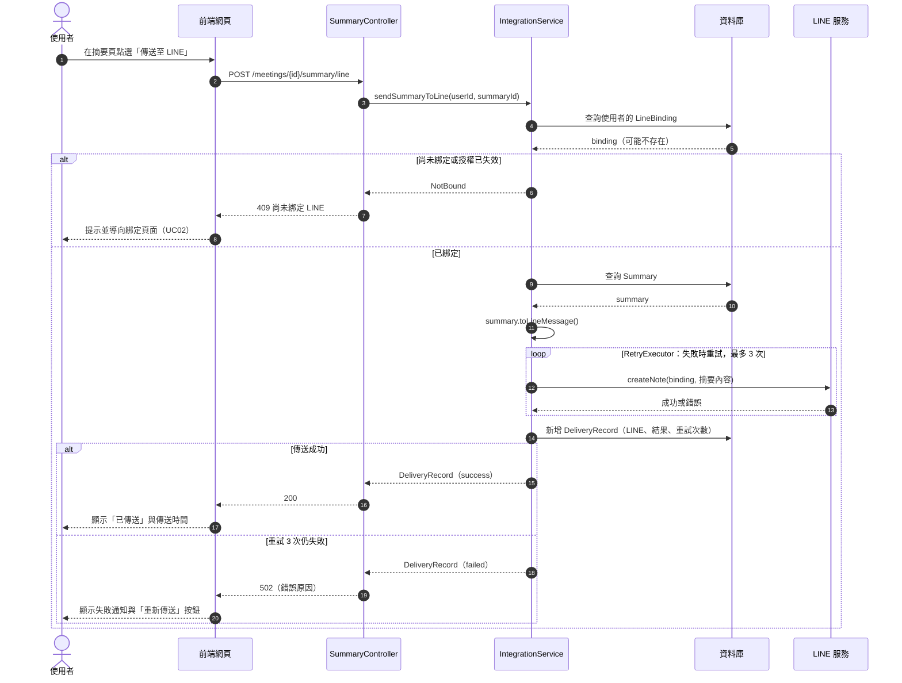
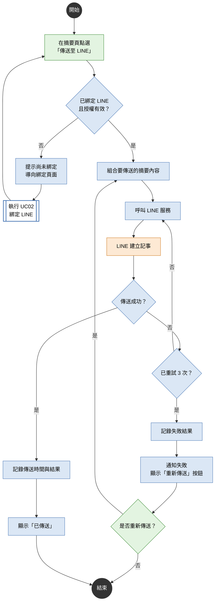
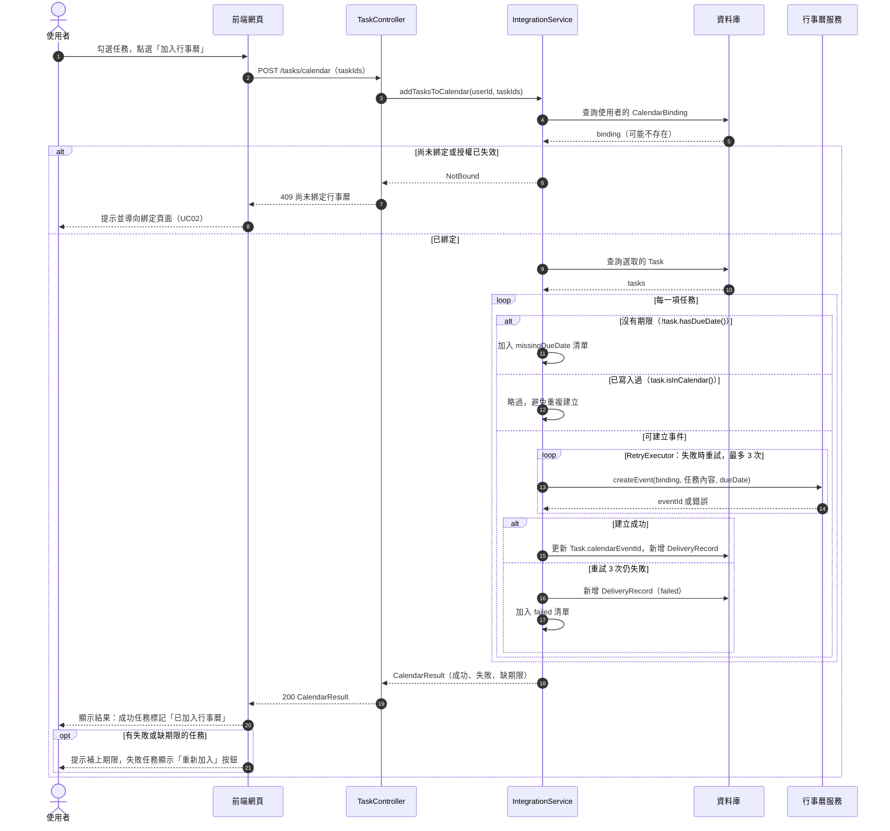
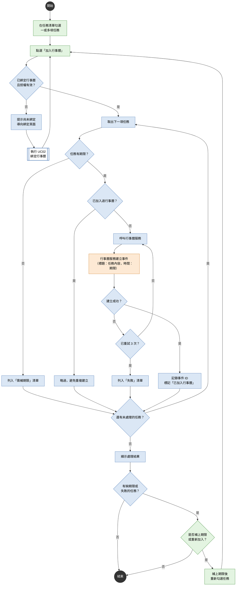

# 小組作業 4：UML 設計

115-1 系統分析與設計 第 5 組｜題目：移動秘書

組長：蔡逸誠｜組員：顏仕祁、林育伸、呂孟澤、施誠軒

## 0. 文件說明

本文件延續作業 3 的需求分析（功能性需求 FR、使用案例 UC），進一步以 UML 描述系統的靜態結構與動態行為。

**本文件涵蓋：**

1. UML 類別圖：分為「領域模型」（系統要保存的資料）與「設計類別」（負責處理流程的控制器、服務與外部服務介面）兩張。
2. 循序圖與活動圖：針對 4 個使用案例，各自繪製一張循序圖與一張活動圖。

| 使用案例 | 選擇原因 | 循序圖 | 活動圖 |
|---|---|---|---|
| UC03 上傳會議音檔（含 UC04、UC05） | 系統核心流程，串接 ASR 與 LLM 兩個外部服務 | 2.1.1 | 2.1.2 |
| UC06 檢視與編輯摘要 | 使用者最常操作的頁面，含權限檢查與資料驗證 | 2.2.1 | 2.2.2 |
| UC08 傳送摘要至 LINE | 自動化整合功能，含綁定檢查與失敗重試 | 2.3.1 | 2.3.2 |
| UC09 任務寫入行事曆 | 自動化整合功能，需逐筆處理多項任務 | 2.4.1 | 2.4.2 |

**設計上的調整：** 作業 3 的處理狀態為「等待中、辨識中、完成、失敗」。設計時在辨識完成後另外加入「摘要中」狀態，讓使用者能分辨目前是 ASR 還是 LLM 在處理，失敗時也能判斷要從哪一步重新處理。

---

## 1. UML 類別圖

### 1.1 領域模型（實體類別）

描述系統需要長期保存的資料，以及資料之間的關係。

| 類別 | 中文名稱 | 說明 | 對應需求 |
|---|---|---|---|
| User | 使用者 | 系統帳號，密碼只保存雜湊值。 | FR-01、FR-02、NFR-03 |
| ExternalBinding | 外部帳號綁定（抽象類別） | 保存外部服務的授權資訊，由 LineBinding 與 CalendarBinding 繼承。 | FR-03 |
| LineBinding／CalendarBinding | LINE 綁定／行事曆綁定 | 各服務特有的欄位，例如 LINE 使用者 ID、行事曆 ID 與時區。 | FR-03 |
| Meeting | 會議 | 一次上傳產生一場會議，是音檔、逐字稿、摘要與任務的擁有者。 | FR-04～FR-06 |
| AudioFile | 音檔 | 上傳的原始音檔與儲存位置。 | FR-04 |
| Transcript | 逐字稿 | ASR 辨識結果。 | FR-05 |
| Summary | 會議摘要 | LLM 整理出的討論重點與決議事項，使用者可編輯。 | FR-07、FR-09 |
| Task | 待辦任務 | 由 LLM 擷取或使用者新增，`calendarEventId` 有值表示已寫入行事曆。 | FR-08、FR-10～FR-12 |
| DeliveryRecord | 傳送紀錄 | 記錄每次傳送至 LINE 或寫入行事曆的結果與重試次數，供失敗通知與重送使用。 | FR-13～FR-15 |

**關係說明：**

- **組合（實心菱形）：** 會議、外部綁定屬於使用者；音檔、逐字稿、摘要、任務屬於會議。刪除上層物件時，下層資料一併刪除，對應 NFR-04「刪除後同步刪除相關資料」。
- **一般化（空心三角形）：** LINE 綁定與行事曆綁定共用授權欄位與 `isValid()`、`unbind()` 等方法。
- **多重性：** 一位使用者最多綁定 2 個外部帳號（LINE、行事曆各一）；逐字稿與摘要在處理完成前不存在，因此為 `0..1`。

### 1.2 設計類別（控制器、服務與外部服務介面）

描述處理使用者請求的類別。資料存取一律透過 Repository 類別，為避免圖面過於複雜，Repository 不畫出。

| 層級 | 類別 | 職責 |
|---|---|---|
| 控制器 | AccountController、MeetingController、SummaryController、TaskController | 接收前端 API 請求、檢查登入與資料擁有者，再交給服務處理。 |
| 服務 | AuthService | 密碼雜湊、發放登入憑證、取得目前登入的使用者。 |
| 服務 | AudioStorageService | 儲存與刪除音檔。 |
| 服務 | MeetingProcessingService | 背景執行「辨識 → 摘要」流程並更新會議狀態。 |
| 服務 | IntegrationService | 傳送摘要至 LINE、將任務寫入行事曆，並記錄 DeliveryRecord。 |
| 服務 | RetryExecutor | 統一處理外部服務呼叫失敗時的重試，最多 3 次（NFR-07）。 |
| 介面 | SpeechRecognizer、Summarizer、LineGateway、CalendarGateway | 外部服務的抽象介面，服務只依賴介面，之後更換 ASR 或 LLM 供應商時只需新增 Adapter（NFR-08）。 |
| 轉接器 | IAIAsrAdapter、LlmAdapter、LineAdapter、CalendarAdapter | 實作介面，負責實際呼叫 iAI ASR、LLM、LINE、行事曆的 API。 |

---

## 2. 循序圖與活動圖

- **循序圖** 的參與者與第 1.2 節的類別名稱一致；「資料庫」代表各 Repository 與資料庫。`loop` 表示重試或逐筆處理，`alt` 表示條件分支，`par` 表示同時進行。
- **活動圖** 以顏色區分執行者：綠色為使用者、藍色為移動秘書系統、橘色為外部服務；菱形為判斷，雙框方塊為呼叫其他使用案例。

### 2.1 UC03 上傳會議音檔（含 UC04、UC05）

#### 2.1.1 循序圖

上傳完成後系統立即回應，辨識與摘要在背景執行；前端同時定期查詢處理狀態。

#### 2.1.2 活動圖

### 2.2 UC06 檢視與編輯摘要

#### 2.2.1 循序圖

#### 2.2.2 活動圖

### 2.3 UC08 傳送摘要至 LINE

#### 2.3.1 循序圖

#### 2.3.2 活動圖

### 2.4 UC09 任務寫入行事曆

#### 2.4.1 循序圖

系統逐筆處理勾選的任務：沒有期限的任務不建立事件；已寫入過的任務直接略過，避免重複建立（對應 UC09 例外流程 4a）。

#### 2.4.2 活動圖

---

## 3. 圖表與需求對照

| 圖表 | 涵蓋使用案例 | 涵蓋需求 |
|---|---|---|
| 1.1 領域模型 | 全部 | FR-01～FR-15、NFR-03、NFR-04 |
| 1.2 設計類別 | 全部 | NFR-07（RetryExecutor）、NFR-08（介面與 Adapter） |
| 2.1 循序圖／活動圖 | UC03、UC04、UC05 | FR-04、FR-05、FR-07、FR-08、NFR-02、NFR-07 |
| 2.2 循序圖／活動圖 | UC06（擴充 UC08） | FR-09、NFR-04 |
| 2.3 循序圖／活動圖 | UC08（前置 UC02） | FR-13、FR-15、NFR-07 |
| 2.4 循序圖／活動圖 | UC09（前置 UC02） | FR-14、FR-15、NFR-07 |
