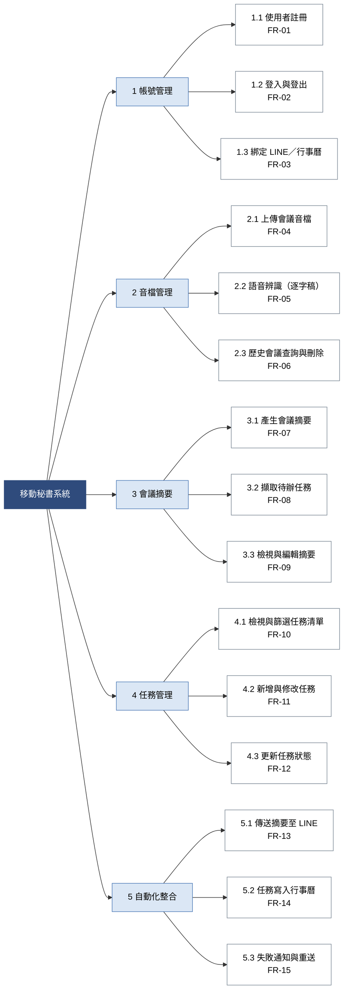
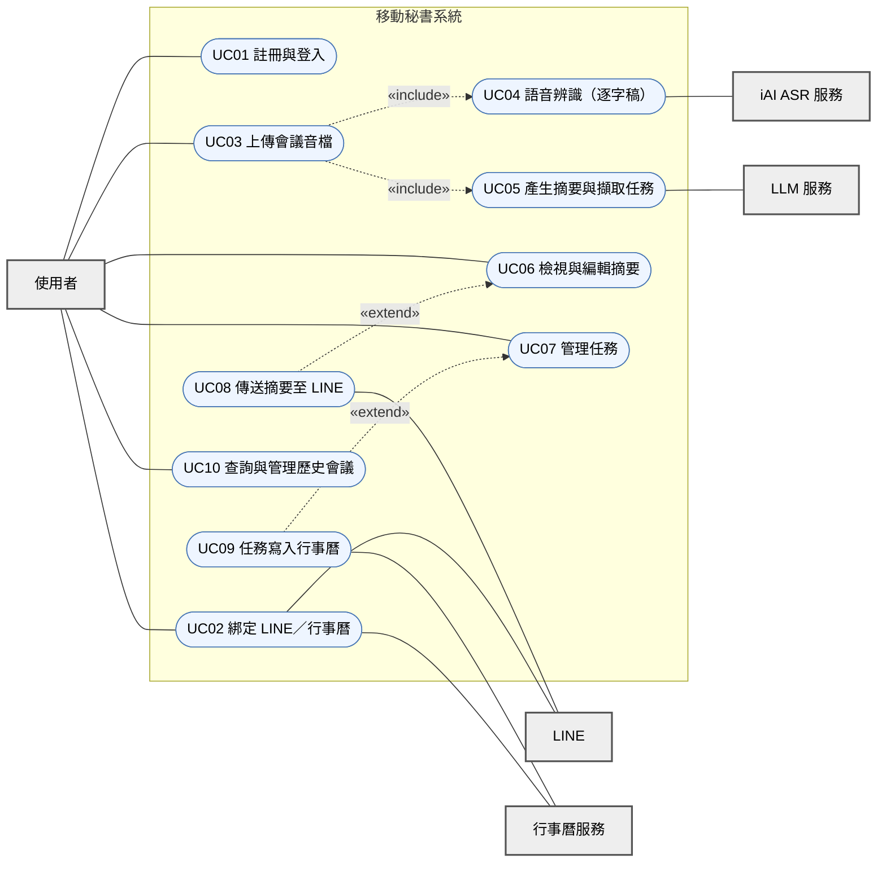

# 小組作業 3：需求分析

115-1 系統分析與設計 第 5 組｜題目：移動秘書

組長：蔡逸誠｜組員：顏仕祁、林育伸、呂孟澤、施誠軒

## 0. 系統簡介

「移動秘書」是網頁版的會議紀錄自動化系統。使用者上傳會議音檔後，系統透過 iAI ASR 產生逐字稿，再由 LLM 整理摘要並擷取待辦任務，最後可自動傳送摘要至 LINE 記事本，或把任務排進行事曆，減少人工整理的流程。

**本文件涵蓋：** 功能性需求、非功能性需求、功能分解圖（FDD）、使用案例圖、使用案例說明。

---

## 1. 功能性需求

優先級：**必須**＝核心功能，缺少則系統無法達成目標；**應該**＝重要但可延後。「對應功能」為第 3 節 FDD 的編號，「對應 UC」為第 4 節的使用案例編號。

| 編號 | 模組 | 需求描述 | 優先級 | 對應功能 | 對應 UC |
|---|---|---|---|---|---|
| FR-01 | 帳號管理 | 系統必須允許新使用者以電子郵件與密碼註冊帳號，並驗證電子郵件格式與是否已被使用。 | 必須 | 1.1 | UC01 |
| FR-02 | 帳號管理 | 系統必須允許已註冊使用者登入與登出，登入失敗時顯示錯誤訊息。 | 必須 | 1.2 | UC01 |
| FR-03 | 帳號管理 | 系統應允許使用者在個人設定中綁定 LINE 與行事曆帳號，並可隨時解除綁定。 | 應該 | 1.3 | UC02 |
| FR-04 | 音檔管理 | 系統必須允許使用者上傳會議音檔（mp3、wav、m4a），並檢查格式，上傳時顯示進度。 | 必須 | 2.1 | UC03 |
| FR-05 | 音檔管理 | 系統必須呼叫 iAI ASR 服務將音檔轉為逐字稿，並顯示處理狀態（等待中、辨識中、完成、失敗）。 | 必須 | 2.2 | UC04 |
| FR-06 | 音檔管理 | 系統應允許使用者查詢歷史會議（依名稱、日期搜尋），並刪除自己的音檔與逐字稿。 | 應該 | 2.3 | UC10 |
| FR-07 | 會議摘要 | 系統必須依逐字稿自動產生會議摘要，內容包含討論重點與決議事項。 | 必須 | 3.1 | UC05 |
| FR-08 | 會議摘要 | 系統必須從逐字稿自動擷取待辦任務，每項任務包含內容、負責人與期限（若逐字稿有提及）。 | 必須 | 3.2 | UC05 |
| FR-09 | 會議摘要 | 系統必須允許使用者檢視逐字稿與摘要，並修改摘要與任務內容後儲存。 | 必須 | 3.3 | UC06 |
| FR-10 | 任務管理 | 系統必須提供任務清單，可依狀態與期限篩選與排序。 | 必須 | 4.1 | UC07 |
| FR-11 | 任務管理 | 系統應允許使用者新增或修改任務的內容、負責人與期限。 | 應該 | 4.2 | UC07 |
| FR-12 | 任務管理 | 系統應允許使用者將任務狀態更新為待辦、進行中、已完成。 | 應該 | 4.3 | UC07 |
| FR-13 | 自動化整合 | 系統必須允許使用者將會議摘要一鍵傳送至已綁定的 LINE 記事本。 | 必須 | 5.1 | UC08 |
| FR-14 | 自動化整合 | 系統必須允許使用者將待辦任務寫入已綁定的行事曆，並以任務期限作為事件時間。 | 必須 | 5.2 | UC09 |
| FR-15 | 自動化整合 | 系統必須在傳送至 LINE 或寫入行事曆失敗時通知使用者，並提供重新傳送的操作。 | 必須 | 5.3 | UC08、UC09 |

---

## 2. 非功能性需求

下表的數值為小組訂定的目標值，會在系統測試階段驗證，必要時依實際結果調整。

| 編號 | 類別 | 需求描述 | 衡量方式 |
|---|---|---|---|
| NFR-01 | 效能 | 一般頁面（登入、清單、摘要檢視）載入時間不得超過 3 秒。 | 在一般校園網路下以瀏覽器開發工具量測，取 20 次的 95 百分位。 |
| NFR-02 | 效能 | 音檔辨識與摘要的總處理時間，應不超過音檔長度的一半（例如 60 分鐘音檔在 30 分鐘內完成）。 | 以不同長度的測試音檔量測上傳完成到摘要產生完成的時間。 |
| NFR-03 | 安全性 | 使用者密碼必須以雜湊方式儲存（例如 bcrypt），不得儲存明文；所有資料傳輸必須使用 HTTPS。 | 檢查資料庫欄位內容與網站憑證設定。 |
| NFR-04 | 隱私 | 音檔、逐字稿與摘要僅限上傳者本人存取；使用者刪除後，系統必須同步刪除相關檔案與資料。 | 以另一個帳號嘗試存取他人資料應被拒絕；刪除後檢查儲存空間與資料庫。 |
| NFR-05 | 易用性 | 新使用者不需教學，應能在 3 個主要操作步驟內完成「上傳音檔並取得摘要」。 | 由未參與該功能開發的組員模擬新使用者實際操作，記錄操作步驟數與是否卡關。 |
| NFR-06 | 相容性 | 網站必須支援最新版 Chrome、Edge、Safari，並採用響應式設計，手機瀏覽器可正常操作。 | 在各瀏覽器與手機螢幕寬度下逐頁檢查。 |
| NFR-07 | 可靠性 | 呼叫外部服務（ASR、LLM、LINE、行事曆）失敗時，系統必須自動重試最多 3 次，且不得遺失使用者已上傳的資料。 | 以模擬外部服務失敗的方式測試，確認重試次數與資料保留。 |
| NFR-08 | 可維護性 | 前端、後端與各處理模組（ASR、摘要、整合）必須透過明確定義的 API 介面溝通，且主要模組須有單元測試。 | 檢查 API 文件與測試報告。 |

---

## 3. 功能分解圖（FDD）

由上而下分解：第一層為系統，第二層為功能模組，第三層為具體功能。葉節點下方標示對應的功能性需求編號。圖形由左向右展開以便閱讀。

---

## 4. 使用案例圖

**參與者：** 使用者（會議主持人或與會者，為主要參與者）；外部系統包含 iAI ASR 服務、LLM 服務、LINE、行事曆服務。

**使用案例：**

| 編號 | 使用案例 | 說明 |
|---|---|---|
| UC01 | 註冊與登入 | 建立帳號並登入系統。除此案例外，其餘使用案例都需先登入。 |
| UC02 | 綁定 LINE／行事曆 | 授權系統存取使用者的 LINE 與行事曆。 |
| UC03 | 上傳會議音檔 | 上傳音檔，並自動進行辨識與摘要。 |
| UC04 | 語音辨識（逐字稿） | 呼叫 iAI ASR 將音檔轉為逐字稿。 |
| UC05 | 產生摘要與擷取任務 | 呼叫 LLM 產生摘要並擷取待辦任務。 |
| UC06 | 檢視與編輯摘要 | 檢視逐字稿、摘要並修改。 |
| UC07 | 管理任務 | 檢視、篩選、修改任務與更新狀態。 |
| UC08 | 傳送摘要至 LINE | 將摘要送到 LINE 記事本。 |
| UC09 | 任務寫入行事曆 | 將任務建立為行事曆事件。 |
| UC10 | 查詢與管理歷史會議 | 搜尋過去的會議、刪除資料。 |

**關係：** UC03 包含（include）UC04 與 UC05，因為上傳後必定會進行辨識與摘要；UC08 擴充（extend）UC06，UC09 擴充 UC07，表示使用者在檢視摘要或任務時可選擇性執行傳送或寫入。

> 圖例：灰色方框為參與者，藍色橢圓為使用案例，實線為關聯，虛線為 include／extend 關係。

---

## 5. 使用案例說明

### UC01 註冊與登入

| 項目 | 內容 |
|---|---|
| 使用案例名稱 | 註冊與登入 |
| 編號 | UC01 |
| 主要參與者 | 使用者 |
| 簡述 | 使用者建立帳號並登入系統，之後才能使用其他功能。 |
| 觸發事件 | 使用者開啟網站並點選「註冊」或「登入」。 |
| 前置條件 | 使用者可連上網站。 |
| 基本流程 | 1. 使用者點選「註冊」。 2. 系統顯示註冊表單（電子郵件、密碼、確認密碼）。 3. 使用者填寫並送出。 4. 系統驗證格式，並確認電子郵件未被註冊過。 5. 系統以雜湊方式儲存密碼，建立帳號。 6. 使用者於登入頁輸入電子郵件與密碼。 7. 系統驗證成功，進入主畫面。 |
| 替代／例外流程 | 4a. 電子郵件格式錯誤或已被使用：系統顯示錯誤訊息，回到步驟 2。 7a. 帳號或密碼錯誤：系統顯示錯誤訊息，使用者可重新輸入。 |
| 後置條件 | 使用者帳號已建立且處於登入狀態。 |
| 對應需求 | FR-01、FR-02、NFR-03 |

### UC03 上傳會議音檔（含 UC04 語音辨識、UC05 產生摘要與擷取任務）

| 項目 | 內容 |
|---|---|
| 使用案例名稱 | 上傳會議音檔 |
| 編號 | UC03 |
| 主要參與者 | 使用者 |
| 次要參與者 | iAI ASR 服務、LLM 服務 |
| 簡述 | 使用者上傳會議音檔，系統自動轉成逐字稿，並產生摘要與待辦任務。 |
| 觸發事件 | 使用者點選「新增會議」。 |
| 前置條件 | 使用者已登入；使用者持有會議音檔（mp3、wav 或 m4a）。 |
| 基本流程 | 1. 使用者輸入會議名稱與日期，並選擇音檔。 2. 系統檢查檔案格式與大小。 3. 系統上傳音檔並顯示上傳進度。 4. 系統呼叫 iAI ASR 服務（include UC04），狀態顯示「辨識中」。 5. ASR 服務回傳逐字稿，系統儲存。 6. 系統將逐字稿送至 LLM 服務（include UC05），產生會議摘要並擷取待辦任務。 7. 系統儲存摘要與任務，狀態改為「完成」並通知使用者。 8. 使用者點選連結進入摘要頁面。 |
| 替代／例外流程 | 2a. 格式不支援或檔案超過系統限制：系統提示原因，回到步驟 1。 3a. 上傳中斷：系統保留已填資料，提示使用者重新上傳。 4a. ASR 服務逾時或失敗：系統自動重試最多 3 次；仍失敗則將狀態標為「失敗」並通知使用者，音檔保留，使用者可稍後重新處理。 6a. LLM 服務失敗：處理方式同 4a，逐字稿保留，可重新產生摘要。 |
| 後置條件 | 音檔、逐字稿、摘要與待辦任務已儲存，使用者可檢視。 |
| 對應需求 | FR-04、FR-05、FR-07、FR-08、NFR-02、NFR-07 |

### UC06 檢視與編輯摘要

| 項目 | 內容 |
|---|---|
| 使用案例名稱 | 檢視與編輯摘要 |
| 編號 | UC06 |
| 主要參與者 | 使用者 |
| 簡述 | 使用者檢視系統產生的逐字稿與摘要，修正錯誤後儲存。 |
| 觸發事件 | 使用者從會議列表選擇一場已處理完成的會議。 |
| 前置條件 | 使用者已登入；該場會議處理狀態為「完成」。 |
| 基本流程 | 1. 系統顯示逐字稿、摘要與待辦任務。 2. 使用者閱讀內容，並點選「編輯」。 3. 使用者修改摘要文字或任務內容（負責人、期限）。 4. 使用者點選「儲存」。 5. 系統驗證內容並更新資料，顯示儲存成功。 |
| 替代／例外流程 | 3a. 使用者放棄修改：系統還原為原內容，不更新資料。 4a. 任務期限格式錯誤：系統提示並標示欄位，回到步驟 3。 5a. 儲存失敗：系統提示錯誤，保留使用者已輸入的內容。 |
| 擴充 | 使用者可在此頁選擇「傳送至 LINE」，執行 UC08。 |
| 後置條件 | 修改後的摘要與任務已儲存。 |
| 對應需求 | FR-09、NFR-04 |

### UC08 傳送摘要至 LINE

| 項目 | 內容 |
|---|---|
| 使用案例名稱 | 傳送摘要至 LINE |
| 編號 | UC08 |
| 主要參與者 | 使用者 |
| 次要參與者 | LINE |
| 簡述 | 使用者將整理好的會議摘要傳送到自己的 LINE 記事本，方便隨時查看。 |
| 觸發事件 | 使用者在摘要頁面點選「傳送至 LINE」。 |
| 前置條件 | 使用者已登入並已綁定 LINE（UC02）；該場會議已有摘要。 |
| 基本流程 | 1. 使用者點選「傳送至 LINE」。 2. 系統確認已綁定 LINE，並組合要傳送的摘要內容。 3. 系統呼叫 LINE 服務傳送。 4. LINE 服務回應成功。 5. 系統顯示「已傳送」並記錄傳送時間。 |
| 替代／例外流程 | 2a. 尚未綁定 LINE：系統提示並導向綁定頁面（UC02）。 3a. LINE 服務失敗或逾時：系統自動重試最多 3 次，仍失敗則通知使用者，並提供「重新傳送」按鈕。 |
| 後置條件 | 摘要已出現在使用者的 LINE 記事本，系統已記錄傳送結果。 |
| 對應需求 | FR-13、FR-15、NFR-07 |

### UC09 任務寫入行事曆

| 項目 | 內容 |
|---|---|
| 使用案例名稱 | 任務寫入行事曆 |
| 編號 | UC09 |
| 主要參與者 | 使用者 |
| 次要參與者 | 行事曆服務 |
| 簡述 | 使用者將會議中擷取的待辦任務建立為行事曆事件，用期限提醒自己。 |
| 觸發事件 | 使用者在任務清單勾選任務並點選「加入行事曆」。 |
| 前置條件 | 使用者已登入並已綁定行事曆（UC02）；任務已設定期限。 |
| 基本流程 | 1. 使用者在任務清單勾選一或多項任務。 2. 使用者點選「加入行事曆」。 3. 系統確認已綁定行事曆，並檢查每項任務皆有期限。 4. 系統呼叫行事曆服務，為每項任務建立事件（標題為任務內容，時間為任務期限）。 5. 行事曆服務回應成功。 6. 系統標記這些任務為「已加入行事曆」並顯示結果。 |
| 替代／例外流程 | 3a. 尚未綁定行事曆：系統提示並導向綁定頁面（UC02）。 3b. 部分任務沒有期限：系統提示使用者先補上期限，未設期限的任務不會建立事件。 4a. 行事曆服務失敗：系統自動重試最多 3 次，仍失敗則通知使用者，並提供「重新加入」按鈕；已成功建立的事件不重複建立。 |
| 後置條件 | 選取的任務已在使用者的行事曆建立事件，系統已記錄結果。 |
| 對應需求 | FR-14、FR-15、NFR-07 |
