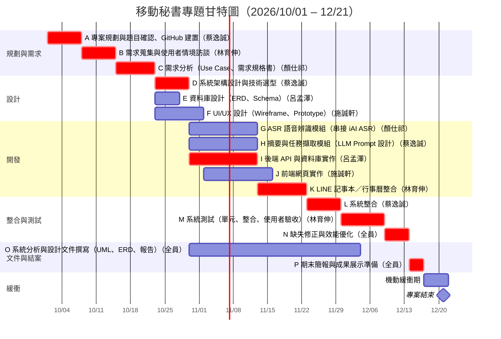
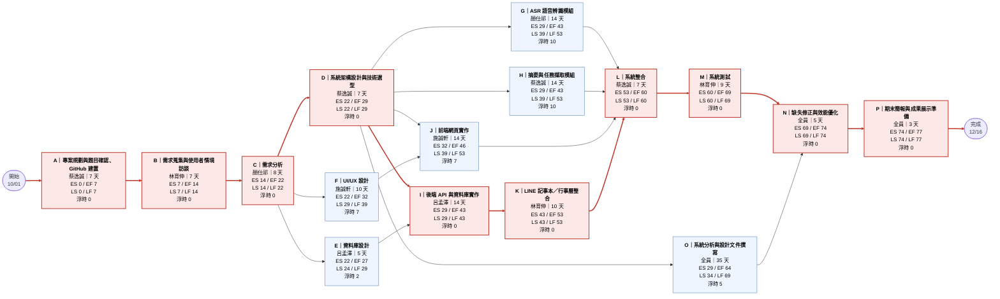

## 專案規劃

- **專題規劃期間：** 2026/10/01 – 2026/12/21（共 82 天）
- **預計完成日：** 2026/12/16（工期 77 天），保留 5 天機動緩衝至 12/21
- **關鍵路徑：** A → B → C → D → I → K → L → M → N → P
### 1. 組員任務分工
 
#### 蔡逸誠
 
**角色：** 組長｜專案管理、系統架構、摘要與任務擷取、系統整合
 
| 編號 | 任務 | 期間 | 天數 | 交付成果 |
|---|---|---|---|---|
| A (關鍵) | 專案規劃與題目確認、GitHub 建置 | 10/01 – 10/07 | 7 | 專案章程、GitHub repo 與分支規範、README |
| D (關鍵) | 系統架構設計與技術選型 | 10/23 – 10/29 | 7 | 系統架構圖、技術選型說明、API 介面草案 |
| H | 摘要與任務擷取模組（LLM Prompt 設計） | 10/30 – 11/12 | 14 | 會議摘要與待辦任務擷取功能、Prompt 版本紀錄 |
| L (關鍵) | 系統整合 | 11/23 – 11/29 | 7 | 整合後可運作的完整系統 |
| O | 負責自己模組的分析與設計文件章節（與全員共同完成 O） | 10/30 – 12/03 | 35 | 所負責模組的 UML 與說明 |
 
#### 顏仕祁
 
**角色：** 需求分析、ASR 語音辨識模組
 
| 編號 | 任務 | 期間 | 天數 | 交付成果 |
|---|---|---|---|---|
| C (關鍵) | 需求分析（Use Case、需求規格書） | 10/15 – 10/22 | 8 | Use Case 圖、需求規格書（SRS） |
| G | ASR 語音辨識模組（串接 iAI ASR） | 10/30 – 11/12 | 14 | 語音上傳與逐字稿功能、iAI ASR 串接程式 |
| O | 負責自己模組的分析與設計文件章節（與全員共同完成 O） | 10/30 – 12/03 | 35 | 所負責模組的 UML 與說明 |
 
#### 林育伸
 
**角色：** 需求蒐集、第三方（LINE／行事曆）整合、測試
 
| 編號 | 任務 | 期間 | 天數 | 交付成果 |
|---|---|---|---|---|
| B (關鍵) | 需求蒐集與使用者情境訪談 | 10/08 – 10/14 | 7 | 訪談紀錄、使用者情境（Persona / Scenario） |
| K (關鍵) | LINE 記事本／行事曆整合 | 11/13 – 11/22 | 10 | 摘要推送 LINE 記事本、任務寫入行事曆 |
| M (關鍵) | 系統測試（單元、整合、使用者驗收） | 11/30 – 12/08 | 9 | 測試計畫、測試報告、使用者驗收紀錄 |
| O | 負責自己模組的分析與設計文件章節（與全員共同完成 O） | 10/30 – 12/03 | 35 | 所負責模組的 UML 與說明 |
 
#### 呂孟澤
 
**角色：** 資料庫設計、後端 API
 
| 編號 | 任務 | 期間 | 天數 | 交付成果 |
|---|---|---|---|---|
| E | 資料庫設計（ERD、Schema） | 10/23 – 10/27 | 5 | ERD、資料表 Schema |
| I (關鍵) | 後端 API 與資料庫實作 | 10/30 – 11/12 | 14 | REST API、資料庫實作 |
| O | 負責自己模組的分析與設計文件章節（與全員共同完成 O） | 10/30 – 12/03 | 35 | 所負責模組的 UML 與說明 |
 
#### 施誠軒
 
**角色：** UI/UX 設計、前端網頁
 
| 編號 | 任務 | 期間 | 天數 | 交付成果 |
|---|---|---|---|---|
| F | UI/UX 設計（Wireframe、Prototype） | 10/23 – 11/01 | 10 | Wireframe、可互動 Prototype |
| J | 前端網頁實作 | 11/02 – 11/15 | 14 | 網頁前端（上傳、摘要檢視、任務清單） |
| O | 負責自己模組的分析與設計文件章節（與全員共同完成 O） | 10/30 – 12/03 | 35 | 所負責模組的 UML 與說明 |
 
> 任務 O（系統分析與設計文件）與 N、P 為全員共同任務。標示「關鍵」的任務位於關鍵路徑上，延誤會直接影響結案日期。
 
### 2. 專案活動明細（含前置關係）
 
| 編號 | 任務 | 負責人 | 期間 | 天數 | 前置 | 交付成果 |
|---|---|---|---|---|---|---|
| A | 專案規劃與題目確認、GitHub 建置 | 蔡逸誠 | 10/01 – 10/07 | 7 | — | 專案章程、GitHub repo 與分支規範、README |
| B | 需求蒐集與使用者情境訪談 | 林育伸 | 10/08 – 10/14 | 7 | A | 訪談紀錄、使用者情境（Persona / Scenario） |
| C | 需求分析（Use Case、需求規格書） | 顏仕祁 | 10/15 – 10/22 | 8 | B | Use Case 圖、需求規格書（SRS） |
| D | 系統架構設計與技術選型 | 蔡逸誠 | 10/23 – 10/29 | 7 | C | 系統架構圖、技術選型說明、API 介面草案 |
| E | 資料庫設計（ERD、Schema） | 呂孟澤 | 10/23 – 10/27 | 5 | C | ERD、資料表 Schema |
| F | UI/UX 設計（Wireframe、Prototype） | 施誠軒 | 10/23 – 11/01 | 10 | C | Wireframe、可互動 Prototype |
| G | ASR 語音辨識模組（串接 iAI ASR） | 顏仕祁 | 10/30 – 11/12 | 14 | D | 語音上傳與逐字稿功能、iAI ASR 串接程式 |
| H | 摘要與任務擷取模組（LLM Prompt 設計） | 蔡逸誠 | 10/30 – 11/12 | 14 | D | 會議摘要與待辦任務擷取功能、Prompt 版本紀錄 |
| I | 後端 API 與資料庫實作 | 呂孟澤 | 10/30 – 11/12 | 14 | D、E | REST API、資料庫實作 |
| J | 前端網頁實作 | 施誠軒 | 11/02 – 11/15 | 14 | D、F | 網頁前端（上傳、摘要檢視、任務清單） |
| K | LINE 記事本／行事曆整合 | 林育伸 | 11/13 – 11/22 | 10 | I | 摘要推送 LINE 記事本、任務寫入行事曆 |
| L | 系統整合 | 蔡逸誠 | 11/23 – 11/29 | 7 | G、H、J、K | 整合後可運作的完整系統 |
| M | 系統測試（單元、整合、使用者驗收） | 林育伸 | 11/30 – 12/08 | 9 | L | 測試計畫、測試報告、使用者驗收紀錄 |
| O | 系統分析與設計文件撰寫（UML、ERD、報告） | 全員 | 10/30 – 12/03 | 35 | D | UML 圖（Class / Sequence / Activity）、系統分析與設計報告 |
| N | 缺失修正與效能優化 | 全員 | 12/09 – 12/13 | 5 | M、O | 缺失修正清單、效能優化紀錄 |
| P | 期末簡報與成果展示準備 | 全員 | 12/14 – 12/16 | 3 | N | 期末簡報、Demo 腳本 |
 
### 3. 專題甘特圖
 

 
> 紅色長條為關鍵路徑任務。
 
### 4. PERT / CPM 圖
 
節點格式：`ES / EF`（最早開始／最早完成）、`LS / LF`（最晚開始／最晚完成），單位為「專案第幾天」（第 0 天 = 10/01）。紅色節點與粗線為關鍵路徑（浮時 = 0）。
 

 
#### CPM 計算表
 
| 編號 | 任務 | 負責人 | 工期(天) | 前置 | ES | EF | LS | LF | 浮時 | 關鍵 |
|---|---|---|---|---|---|---|---|---|---|---|
| A | 專案規劃與題目確認、GitHub 建置 | 蔡逸誠 | 7 | — | 0 | 7 | 0 | 7 | 0 | 是 |
| B | 需求蒐集與使用者情境訪談 | 林育伸 | 7 | A | 7 | 14 | 7 | 14 | 0 | 是 |
| C | 需求分析（Use Case、需求規格書） | 顏仕祁 | 8 | B | 14 | 22 | 14 | 22 | 0 | 是 |
| D | 系統架構設計與技術選型 | 蔡逸誠 | 7 | C | 22 | 29 | 22 | 29 | 0 | 是 |
| E | 資料庫設計（ERD、Schema） | 呂孟澤 | 5 | C | 22 | 27 | 24 | 29 | 2 |  |
| F | UI/UX 設計（Wireframe、Prototype） | 施誠軒 | 10 | C | 22 | 32 | 29 | 39 | 7 |  |
| G | ASR 語音辨識模組（串接 iAI ASR） | 顏仕祁 | 14 | D | 29 | 43 | 39 | 53 | 10 |  |
| H | 摘要與任務擷取模組（LLM Prompt 設計） | 蔡逸誠 | 14 | D | 29 | 43 | 39 | 53 | 10 |  |
| I | 後端 API 與資料庫實作 | 呂孟澤 | 14 | D、E | 29 | 43 | 29 | 43 | 0 | 是 |
| J | 前端網頁實作 | 施誠軒 | 14 | D、F | 32 | 46 | 39 | 53 | 7 |  |
| K | LINE 記事本／行事曆整合 | 林育伸 | 10 | I | 43 | 53 | 43 | 53 | 0 | 是 |
| L | 系統整合 | 蔡逸誠 | 7 | G、H、J、K | 53 | 60 | 53 | 60 | 0 | 是 |
| M | 系統測試（單元、整合、使用者驗收） | 林育伸 | 9 | L | 60 | 69 | 60 | 69 | 0 | 是 |
| O | 系統分析與設計文件撰寫（UML、ERD、報告） | 全員 | 35 | D | 29 | 64 | 34 | 69 | 5 |  |
| N | 缺失修正與效能優化 | 全員 | 5 | M、O | 69 | 74 | 69 | 74 | 0 | 是 |
| P | 期末簡報與成果展示準備 | 全員 | 3 | N | 74 | 77 | 74 | 77 | 0 | 是 |
 
**關鍵路徑：** A → B → C → D → I → K → L → M → N → P，總工期 **77 天**（10/01 – 12/16）。
 
#### PERT 時間風險評估
 
各任務以「樂觀時間 = 期望 − 浮動、悲觀時間 = 期望 + 浮動」估計（浮動值為小組估計，可依實際調整），關鍵路徑變異數合計 4.2、標準差約 2.1 天。距離 12/21 尚有 5 天緩衝，依常態近似，12/21 前完成的機率約 99%。
 
### 5. 里程碑
 
| 日期 | 里程碑 |
|---|---|
| 10/07 | 專案啟動完成（A） |
| 10/22 | 需求規格書完成（C） |
| 10/29 | 系統架構確認（D） |
| 11/22 | 各功能模組開發完成（G/H/J/K） |
| 11/29 | 系統整合完成（L） |
| 12/08 | 測試完成（M） |
| 12/16 | 期末簡報準備完成（P） |
| 12/21 | 專題規劃期限（緩衝結束） |
 
